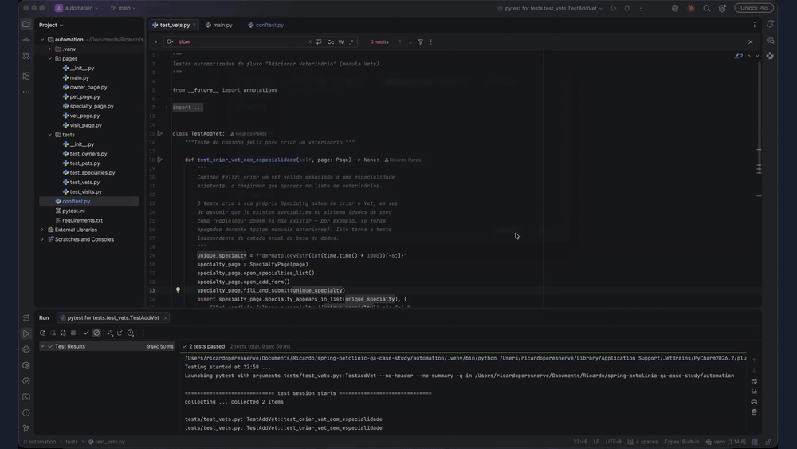
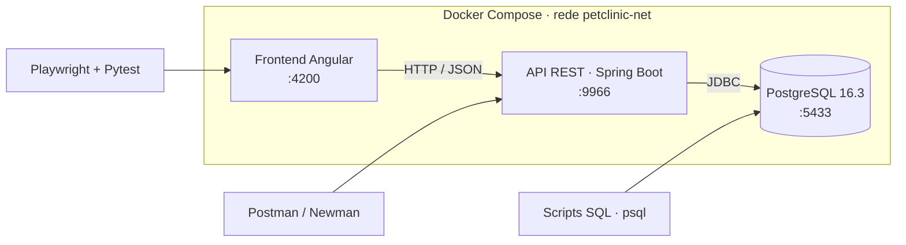
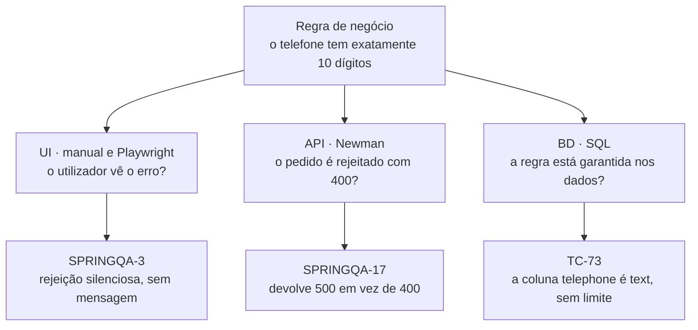
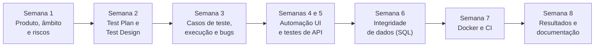
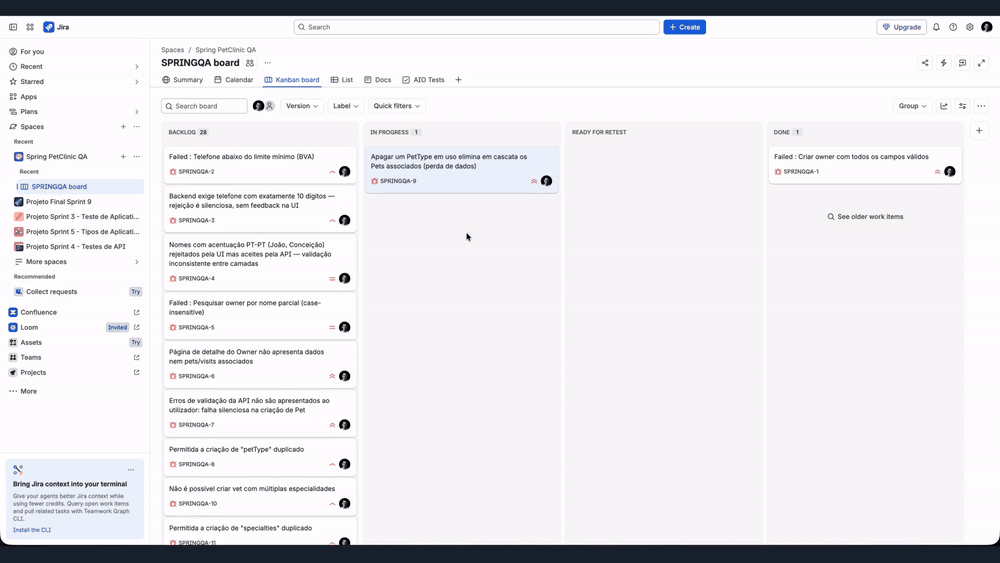
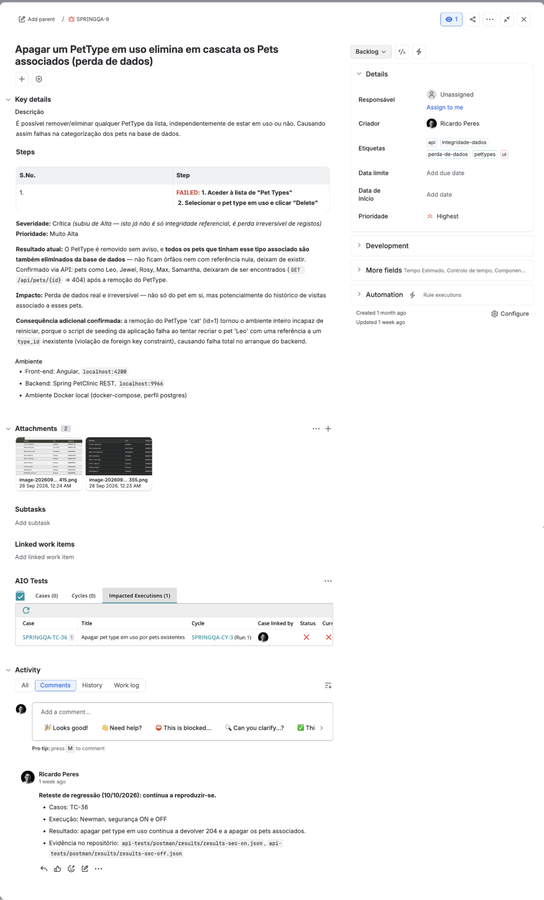
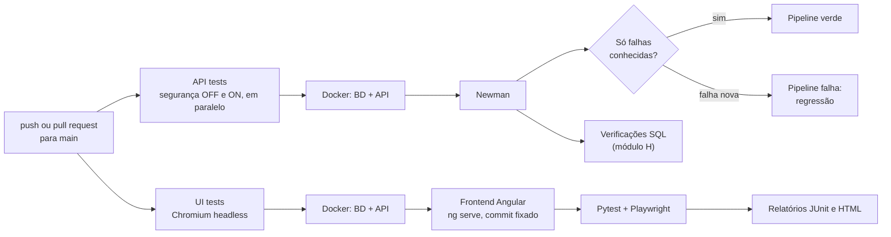
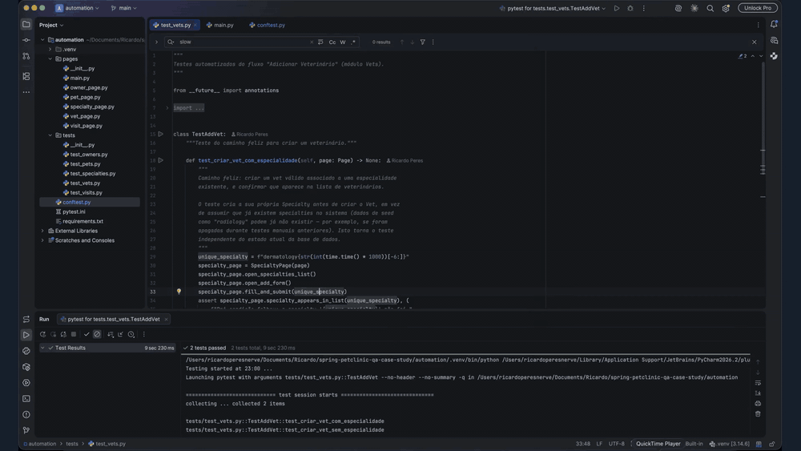

# Spring PetClinic · Caso de Estudo de QA

[](https://github.com/ricardoneto027/spring-petclinic-qa-case-study/actions/workflows/api-tests.yml)
[](https://github.com/ricardoneto027/spring-petclinic-qa-case-study/actions/workflows/ui-tests.yml)

**De Design a Quality Engineering:** um processo de QA completo, do planeamento à integração contínua, aplicado a uma aplicação real que não construí.

> **English summary**
> End-to-end QA case study on [Spring PetClinic REST](https://github.com/spring-petclinic/spring-petclinic-rest) (Angular UI, Spring Boot REST API, PostgreSQL), built in 8 weeks as the portfolio project of TripleTen's Career Acceleration Program. It covers the full testing life cycle: test plan, test design with ISTQB techniques (82 conditions, 106 test cases), manual execution, 29 valid bugs reported in Jira, a Postman/Newman API suite run with security on and off, SQL data-integrity checks, Playwright + Pytest UI automation with the Page Object Model, and two GitHub Actions pipelines on a Dockerized environment. The pipelines use a known-failures baseline, so they only fail on new regressions. Documentation is in Portuguese, the language of the market this portfolio targets.

## Índice

- [Sobre o projeto](#sobre-o-projeto)
- [Em números](#em-números)
- [Demo](#demo)
- [Estratégia e arquitetura](#estratégia-e-arquitetura)
- [Stack e ferramentas](#stack-e-ferramentas)
- [Processo](#processo)
- [Bugs em destaque](#bugs-em-destaque)
- [Automação de UI](#automação-de-ui)
- [Testes de API](#testes-de-api)
- [Integridade de dados (SQL)](#integridade-de-dados-sql)
- [CI/CD com baseline de falhas conhecidas](#cicd-com-baseline-de-falhas-conhecidas)
- [Rastreabilidade](#rastreabilidade)
- [Decisões técnicas](#decisões-técnicas)
- [Como correr](#como-correr)
- [Estrutura do repositório](#estrutura-do-repositório)
- [Documentação](#documentação)
- [Nota sobre o uso de IA](#nota-sobre-o-uso-de-ia)
- [Autor](#autor)

## Sobre o projeto

Este repositório documenta um caso de estudo de QA de ponta a ponta sobre o **Spring PetClinic**, uma aplicação open-source de gestão de uma clínica veterinária com frontend Angular, API REST em Spring Boot e base de dados PostgreSQL.

Muitos portefólios de QA júnior mostram só uma parte do trabalho: um conjunto de testes manuais, ou um script de automação isolado. Quis mostrar o processo como acontece numa equipa real: analisar requisitos e riscos, planear, desenhar casos de teste, executar, reportar e priorizar defeitos, validar dados, automatizar e integrar tudo num pipeline.

Assumi de propósito os três papéis que numa equipa estariam divididos:

- **Test Analyst:** análise de requisitos, design e execução de testes
- **QA Automation Engineer:** automação de UI e de API, integração contínua
- **Test Lead:** planeamento, priorização por risco e reporting

### Do design gráfico para o QA

Trabalho há mais de 5 anos em design gráfico, uma área onde o detalhe, a consistência visual e a experiência do utilizador são centrais. Um designer treina o olho para notar o que "não bate certo" antes de saber explicar porquê, e essa é a mesma mentalidade de QA. Depois do bootcamp de QA Engineering da TripleTen, este projeto foi a forma de provar que consigo aplicar um processo de QA profissional completo. O módulo de UI/UX (26 casos de teste) é onde o background de design mais se nota.

## Em números

| | |
|---|---|
| **82** condições de teste em 10 módulos | **106** casos de teste no AIO Tests |
| **29** bugs válidos no Jira (2 críticos, 5 de severidade alta) | **74** pedidos de API, corridos com a segurança ligada e desligada |
| **8** testes de UI automatizados (Playwright) | **6** verificações de integridade de dados em SQL |
| **2** pipelines de CI no GitHub Actions | **3** camadas testadas: UI, API e base de dados |

## Demo



*A suite de UI a correr localmente, com o browser visível. Na CI, os mesmos testes correm em modo headless.*

## Estratégia e arquitetura

### Ambiente de teste

Toda a aplicação corre em containers, com um único `docker-compose.yml`. Cada ferramenta de teste entra por uma camada diferente:



### A mesma regra, três portas

A estratégia assenta numa ideia simples: uma regra de negócio só está garantida se for respeitada em todas as camadas. Por isso, as regras mais importantes foram testadas pela interface, pela API e pela base de dados. Não é trabalho repetido: cada camada responde a uma pergunta diferente e encontra defeitos diferentes.



Outras decisões de estratégia:

- **Manual antes de automatizar:** os casos foram primeiro executados à mão. Só depois se automatizaram os fluxos críticos e estáveis.
- **Priorização por risco:** os riscos identificados na semana 1 (apagar registos com dependências, duplicados, autorização) definiram a ordem de execução e a prioridade dos casos.
- **Segurança ligada e desligada:** a API corre sem autenticação por defeito. A suite de API corre nos dois modos, para testar também a autenticação e as permissões por role.

## Stack e ferramentas

| Área | Ferramentas |
|---|---|
| Gestão de testes e defeitos | Jira, AIO Tests |
| Testes de API | Postman, Newman, newman-reporter-htmlextra |
| Automação de UI | Playwright (Python), Pytest, Page Object Model |
| Base de dados | PostgreSQL 16.3, SQL, psql |
| Ambiente | Docker, Docker Compose |
| CI/CD | GitHub Actions |
| Documentação | Markdown, Confluence |
| Técnicas de design de testes (ISTQB) | Partição de equivalência, análise de valores-limite, tabelas de decisão, error guessing, testes baseados em risco |

## Processo

O projeto seguiu o ciclo de vida de testes, em 8 semanas e com 10 a 15 horas por semana:



| Fase | Entregável |
|---|---|
| Planeamento | [Test Plan](docs/test-plan.md): âmbito, riscos, estratégia, critérios de entrada e saída, ambiente e cronograma |
| Design | [Test Design](docs/test-design.md): 82 condições em 10 módulos, com a técnica ISTQB indicada em cada uma |
| Casos de teste | 106 casos no AIO Tests (Jira), um resultado esperado por caso |
| Execução e defeitos | Execução manual por ciclos, 29 bugs no Jira com passos, evidência, prioridade e severidade |
| Automação e CI | Suites de API, UI e SQL a correr no GitHub Actions |
| Fecho | [Test Results](docs/test-results.md): resultados consolidados de todas as camadas |

## Bugs em destaque

O Jira e o AIO Tests são privados, por isso os defeitos mais graves ficam resumidos aqui. A lista completa dos 29 está em [docs/test-results.md](docs/test-results.md#6-defeitos-jira).

| Bug | O que acontece | Severidade | Como foi encontrado |
|---|---|---|---|
| SPRINGQA-9 | Apagar um PetType em uso apaga todos os pets desse tipo. Depois de apagar "cat", o backend deixa de arrancar, porque o script de seed falha numa chave estrangeira. | Crítica | Manual (UI), confirmado pela API |
| SPRINGQA-11 | É possível criar specialties duplicadas. | Crítica | Manual (UI) e API |
| SPRINGQA-6 | A página de detalhe do owner não mostra dados, pets nem visitas. Bloqueia a verificação de pets e visitas pela interface. | Alta | Manual (UI) |
| SPRINGQA-7 | Criar um pet com data de nascimento no futuro falha sem mensagem: o utilizador julga que gravou. | Alta | Manual (UI), automatizado com `xfail` |
| SPRINGQA-3 | O backend exige telefone com exatamente 10 dígitos e a UI não mostra o erro. Um telemóvel português (9 dígitos) é rejeitado em silêncio. | Alta | Manual (UI), automatizado com `xfail` |
| SPRINGQA-26 | Os utilizadores criados pela API não se conseguem autenticar. A password fica em texto simples na base de dados e é devolvida na resposta. | Alta | API (Newman), confirmado por SQL |
| SPRINGQA-23 | Apagar um pet apaga também as suas visitas, sem aviso nem bloqueio. | Alta | API (Newman) |
| SPRINGQA-17 | Erros de validação devolvem 500 em vez de 400. Está relacionado com as falhas silenciosas da UI. | Média | API (Newman) |
| SPRINGQA-20 | Apagar um registo com dependências devolve 404 em vez de 409. | Média | API (Newman) |



<details>
<summary><strong>Exemplo de bug report completo (SPRINGQA-9)</strong></summary>

Cada report tem passos para reproduzir, resultado esperado e atual, severidade e prioridade, ambiente e evidência. Está ligado ao caso de teste no AIO e tem um comentário em cada reteste.



</details>

## Automação de UI

Playwright com Python e Pytest, organizado com o padrão **Page Object Model**:

- `automation/pages/`: uma Page por área da aplicação (Owners, Pets, Visits, Vets, Specialties), todas a herdar de uma `BasePage` (`main.py`). A `BasePage` centraliza as esperas explícitas, por isso não há `time.sleep` em nenhum teste.
- `automation/tests/`: um ficheiro de testes por módulo.
- `automation/conftest.py`: um browser por sessão e um contexto novo por teste, para que os testes não partilhem estado. Na CI corre em modo headless; localmente abre o browser em câmara lenta, para se ver a execução.

Os seletores e as rotas foram confirmados no código-fonte do `spring-petclinic-angular`, não adivinhados. Um exemplo: os campos de data esperam o formato `YYYY/MM/DD`, com barras, tal como está definido em `pets.module.ts`.

**Bugs conhecidos ficam na suite, marcados com `xfail`.** O teste descreve o comportamento correto e falha enquanto o bug existir. Quando o bug for corrigido, o teste passa a passar e o Pytest assinala-o:

```python
@pytest.mark.xfail(
    reason="Bug conhecido (SPRINGQA-3): o backend rejeita telefones com 9 dígitos, "
           "mas a UI não mostra nenhum erro ao utilizador (falha silenciosa).",
    strict=False,
)
def test_criar_owner_telefone_9_digitos_bug_conhecido(self, page: Page) -> None:
    ...
    assert not owner_page.owner_appears_in_list("Joao TesteDigitos")
    owner_page.assert_visible("text=must be exactly 10 digits")
```

**Resultado (CI, 21/10/2026):** 8 testes, 4 Pass, 4 xfail e 0 falhas.

## Testes de API

Coleção Postman com **74 pedidos**, organizada por módulo. Cada pedido tem o ID do caso de teste do AIO no nome (por exemplo, `SPRINGQA-TC-36`). Cada pedido cria os seus próprios dados num pré-pedido, e uma limpeza automática apaga-os antes do pedido seguinte. Assim, os pedidos são independentes e a base de dados não acumula dados de teste.

A API corre sem autenticação por defeito. Por isso a coleção corre em dois modos, com um environment para cada:

| | Segurança OFF | Segurança ON |
|---|---:|---:|
| Asserções | 165 | 173 |
| Asserções que falham | 29 | 39 |
| Casos com falha | 16 | 23 |
| Falhas que não são bugs conhecidos | **0** | **0** |

Todas as falhas correspondem a bugs abertos no Jira. Com a segurança ligada, os testes de utilizadores e roles (módulo G) correm por completo, o que explica as falhas a mais. A password de administração não está guardada nos environments: é passada na linha de comandos com `--env-var`.

## Integridade de dados (SQL)

O script `sql/H_integrity_checks.sql` só faz `SELECT` e não altera dados. Cada verificação devolve as linhas "más": 0 linhas é Pass. Corre manualmente e também no fim de cada pipeline de API, depois do Newman.

| Verificação | Resultado |
|---|---|
| Chaves estrangeiras, registos órfãos, unicidade | Pass |
| Constraints da BD vs validações da API | Fail: 12 passwords sem hash BCrypt (SPRINGQA-26) e colunas de texto sem limite de tamanho |
| Resposta da API igual aos dados na BD | Pass |
| Persistência após reiniciar os containers | Pass, com uma observação: a cada arranque do backend são criados índices duplicados (SPRINGQA-29) |

## CI/CD com baseline de falhas conhecidas

Dois workflows no GitHub Actions correm em cada push e pull request para `main`, e também à mão:



**O problema:** a suite tem testes que falham de propósito, porque documentam bugs abertos. Um pipeline que falha sempre deixa de ser lido; um que ignora todas as falhas esconde regressões.

**A solução:** o script `ci/check_newman_results.py` compara cada execução com uma lista de falhas conhecidas (`ci/known-failures-sec-off.txt` e `ci/known-failures-sec-on.txt`), com um caso de teste e o bug correspondente por linha:

- uma falha num caso que não está na lista faz falhar o pipeline (regressão);
- um caso da lista que passa a passar gera um aviso (o bug pode ter sido corrigido e deve ser retestado);
- uma execução sem pedidos também faz falhar o pipeline.

Na UI, o mesmo papel é feito pelo `xfail`. Cada execução publica os resultados como artefactos (relatórios HTML, JSON, JUnit e a saída SQL) e escreve um resumo na página do run.



## Rastreabilidade

Cada resultado liga-se ao resto da cadeia:

**Condição no Test Design → caso no AIO → execução (manual, API, UI ou SQL) → bug no Jira → teste automatizado que o documenta**

| Camada | Como se liga ao AIO |
|---|---|
| API | O nome de cada pedido da coleção começa pelo ID do caso (`SPRINGQA-TC-n`) |
| SQL | Cada verificação em `sql/H_integrity_checks.sql` indica o caso (TC-70 a TC-75) |
| CI | As listas de falhas conhecidas ligam cada caso ao seu bug |
| UI | Tabela abaixo |

| Teste automatizado | Caso AIO | Resultado | Bug |
|---|---|---|---|
| `test_owners.py::test_criar_owner_valido` | SPRINGQA-TC-1 | Pass | |
| `test_owners.py::test_criar_owner_telefone_9_digitos_bug_conhecido` | SPRINGQA-TC-9 | xfail | SPRINGQA-3 |
| `test_pets.py::test_adicionar_pet_valido` | SPRINGQA-TC-21 | xfail | SPRINGQA-6 |
| `test_pets.py::test_adicionar_pet_data_nascimento_futura_bug_conhecido` | SPRINGQA-TC-24 | xfail | SPRINGQA-7 |
| `test_specialties.py::test_criar_specialty_valida` | SPRINGQA-TC-45 | Pass | |
| `test_vets.py::test_criar_vet_com_especialidade` | SPRINGQA-TC-39 | Pass | |
| `test_vets.py::test_criar_vet_sem_especialidade` | SPRINGQA-TC-40 | Pass | |
| `test_visits.py::test_adicionar_visita_valida` | SPRINGQA-TC-49 | xfail | SPRINGQA-6 |

O mapa completo, por camada e por bug, está em [docs/test-results.md](docs/test-results.md).

## Decisões técnicas

- **Selenium → Playwright a meio do projeto.** Para aprender uma ferramenta cada vez mais pedida no mercado e diferenciar o perfil. A arquitetura Page Object Model definida no Test Plan manteve-se.
- **`xfail` em vez de apagar testes que falham.** Um bug conhecido fica documentado na suite, e a correção é detetada automaticamente.
- **Baseline de falhas conhecidas na CI.** O pipeline fica verde com bugs abertos e documentados, e falha só com problemas novos.
- **Seletores confirmados no código-fonte.** Evita testes frágeis baseados em suposições sobre o HTML.
- **Esperas condicionais, nunca pausas fixas.** A primeira execução na CI expôs uma race condition: em modo headless, o teste lia a lista de specialties antes de ela atualizar. A correção foi esperar até o valor aparecer, com limite de tempo.
- **Frontend fixado num commit na CI.** O pipeline testa sempre a mesma versão do Angular que foi testada localmente, por isso os resultados são reproduzíveis.
- **Credenciais fora do repositório.** A password de administração é passada com `--env-var`, e as configurações locais ficam num `docker/.env` ignorado pelo Git (há um `.env.example` como modelo).
- **Docker como apoio, não como foco.** O objetivo do Docker é ter um ambiente igual no Mac e na CI.

## Como correr

**Pré-requisitos:** Docker Desktop, Python 3.12, Node.js 22 e Git.

### 1. Ambiente

```bash
git clone https://github.com/ricardoneto027/spring-petclinic-qa-case-study.git
git clone https://github.com/spring-petclinic/spring-petclinic-angular.git
cd spring-petclinic-qa-case-study/docker
cp .env.example .env    # indicar em ANGULAR_DIR o caminho do spring-petclinic-angular
docker compose up -d    # BD + API + frontend
```

| Serviço | Endereço |
|---|---|
| Frontend | http://localhost:4200/petclinic/ |
| API | http://localhost:9966/petclinic/api |
| Swagger | http://localhost:9966/petclinic/swagger-ui/index.html |
| PostgreSQL | `localhost:5433` (utilizador e password: `petclinic`) |

O frontend demora alguns minutos a arrancar da primeira vez (`npm install`). Para os testes de API e SQL basta `docker compose up -d postgres backend`.

### 2. Testes de API (Newman)

Na raiz do repositório:

```bash
npm install -g newman newman-reporter-htmlextra
newman run api-tests/postman/PetClinic.postman_collection.json \
  -e api-tests/postman/environments/PetClinic.postman_environment_sec-off.json \
  --env-var "adminPassword=admin" --env-var "securityEnabled=false" \
  -r cli,json,htmlextra --reporter-json-export results-sec-off.json
python3 ci/check_newman_results.py results-sec-off.json ci/known-failures-sec-off.txt
```

Para correr com a segurança ligada, reiniciar o backend (na pasta `docker/`) e usar o environment `sec-on`:

```bash
PETCLINIC_SECURITY_ENABLE=true docker compose up -d --force-recreate backend
```

Nos comandos do Newman, trocar `sec-off` por `sec-on` e usar `securityEnabled=true`. `admin`/`admin` é a credencial pública de demonstração do Spring PetClinic.

### 3. Testes de UI (Playwright)

```bash
cd automation
python3 -m venv .venv && source .venv/bin/activate
pip install -r requirements.txt
python -m playwright install chromium
pytest -v -rxXs              # abre o browser em câmara lenta
HEADLESS=true pytest -v -rxXs  # sem interface, como na CI
```

### 4. Verificações SQL

Na raiz do repositório:

```bash
docker exec -i petclinic-postgres psql -U petclinic -d petclinic < sql/H_integrity_checks.sql
```

Para parar o ambiente: `docker compose down` na pasta `docker/` (com `-v` apaga também os dados).

## Estrutura do repositório

```
.
├── .github/workflows/   pipelines de API (Newman) e de UI (Playwright)
├── api-tests/postman/   coleção, environments (sec-on e sec-off), resultados e relatórios de referência
├── automation/          Playwright + Pytest: pages/, tests/ e conftest.py
├── ci/                  verificação da baseline e listas de falhas conhecidas
├── docker/              docker-compose.yml e .env.example
├── docs/                Test Plan, Test Design, Test Results e imagens
├── reports/             resultados da CI: API (OFF e ON, com a saída SQL) e UI
└── sql/                 verificações de integridade de dados (módulo H)
```

## Documentação

| Documento | Conteúdo |
|---|---|
| [Test Plan](docs/test-plan.md) | Âmbito, riscos, estratégia, critérios, ambiente e cronograma |
| [Test Design](docs/test-design.md) | 82 condições de teste em 10 módulos, com técnicas ISTQB |
| [Test Results](docs/test-results.md) | Resultados consolidados, lista completa de defeitos e critérios de saída |

## Nota sobre o uso de IA

Este projeto foi desenvolvido com o apoio de IA, usada como assistente de processos e para agilizar o trabalho: preparar estruturas e código, rever documentação e discutir abordagens. Todas as decisões e ações foram minhas: o âmbito, a estratégia, as prioridades, a execução dos testes, a decisão sobre o que é ou não um bug, o registo no Jira e cada commit. Os resultados foram sempre confirmados contra evidência real, como o código da aplicação, as respostas da API e os dados na base de dados.

Foi também neste projeto que aprendi Playwright, Docker e GitHub Actions.

## Autor

**Ricardo Peres** · QA Engineer, vindo do design gráfico

[LinkedIn](https://www.linkedin.com/in/ricardo-peres027) · [GitHub](https://github.com/ricardoneto027)

Projeto desenvolvido no Programa de Aceleração de Carreira (PAC) da TripleTen. A aplicação sob teste é o [Spring PetClinic](https://github.com/spring-petclinic), um projeto open-source da comunidade Spring.
